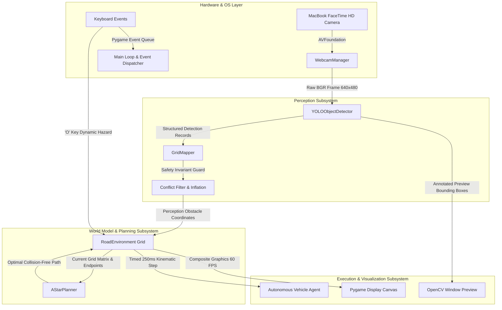

# System Architecture & Data Flow

## Adaptive Path Planning and Collision Avoidance on Unstructured Roads

This document describes the software architecture, modular data flow, safety invariants, and thread/timing models for the **Adaptive Path Planning and Collision Avoidance** autonomous navigation testbed.

---

## 1. High-Level Architecture Overview

The system is organized into four decoupled packages:
1. **`perception/`**: Monocular video capture (`WebcamManager`), deep-learning inference (`YOLOObjectDetector`), and spatial projection (`GridMapper`).
2. **`planning/`**: Graph-based optimal path computation (`AStarPlanner`, `AStarResult`).
3. **`simulation/`**: Terrain model, dynamic obstacles, kinematic pacing, and Pygame HUD (`RoadEnvironment`).
4. **`tools/`**: Standalone testing utilities and benchmark engines (`benchmark_suite.py`).

### End-to-End Component Architecture



---

## 2. Multi-Stage Data Flow Pipeline

The end-to-end data pipeline executes in 7 sequential phases per tick:

```text
[Camera Hardware] ──(1) BGR Frames──> [WebcamManager]
                                              │
                                       (2) Raw Array (640x480)
                                              ▼
                                    [YOLOObjectDetector]
                                              │
                                    (3) List[Detection]
                                        (class_id, conf, bbox)
                                              ▼
                                        [GridMapper]
                                              │
                       ┌──────────────────────┴──────────────────────┐
                       │                                             │
                       ▼                                             ▼
          [ROI Spatial Filter]                         [Contact Point Proxy]
       (Discard peripheral noise)                    (Bottom-center cx, y2)
                       │                                             │
                       └──────────────────────┬──────────────────────┘
                                              ▼
                                  [Safety Guard Verification]
                            (Reject Vehicle & Goal Collisions)
                                              │
                                              ▼
                                   [Grid Inflation Radius]
                                              │
                                       (4) Set[(row, col)]
                                              ▼
                                    [RoadEnvironment Map]
                                              │
                                       (5) Lookahead Check
                                              ▼
                             Is Active Route Blocked?
                                    ├── YES ──> [A* Planner] ──> New Detour Path
                                    └── NO  ──> Continue 4 Hz Paced Waypoint Step
```

### Phase 1: Hardware-Isolated Video Acquisition
- The **`WebcamManager`** initializes an OpenCV `VideoCapture` object backed by macOS **`AVFoundation`**.
- It checks system profiler data to isolate the physical **FaceTime HD Camera** (index 0) while ignoring paired iPhones (Apple Continuity Camera).
- Capture executes inside a dedicated daemon worker thread (`_capture_worker`), continuously populating a single-slot bounded buffer (`_latest_frame`).
- This decouples USB/AVFoundation hardware latency from the main application thread.

### Phase 2: Local Neural Object Detection
- **`YOLOObjectDetector`** runs inference on raw video frames using a local pretrained **YOLOv11 nano** model (`yolo11n.pt`).
- Inference runs on Apple Silicon GPU/MPS or CPU with zero external API calls or network requests.
- Detections are parsed into strongly-typed `Detection` objects containing:
  - `class_id` and `class_name` (e.g., `bottle`, `cup`, `chair`, `person`).
  - `confidence` (0.0 to 1.0).
  - Pixel bounding box `(x1, y1, x2, y2)`.
  - Derived geometric properties (`width`, `height`, `center`).

### Phase 3: Spatial Filtering & Ground-Contact Projection
- The **`GridMapper`** receives candidate detections and applies two spatial transformations:
  1. **Region-of-Interest (ROI) Filtering**: Ignores detections outside the configured normalized bounding box $[u_{min}, v_{min}, u_{max}, v_{max}]$ (default: $[0.05, 0.10, 0.95, 0.95]$) to eliminate edge distortions.
  2. **Ground-Contact Point Proxy**: Uses the bottom-center coordinate $(cx, y_2) = (x_1 + w/2, y_2)$ of each bounding box as the physical contact proxy on the ground plane.
  3. **Linear Coordinate Normalization**: Maps normalized ROI coordinates $(u_{norm}, v_{norm})$ to discrete grid indices:
     $$r = \lfloor v_{norm} \times (\text{rows} - 1) \rfloor, \quad c = \lfloor u_{norm} \times (\text{cols} - 1) \rfloor$$

### Phase 4: Safety Invariant Verification (Safety Guard)
Before candidate obstacle cells reach the world map, `GridMapper` evaluates two strict safety invariants:
- **Vehicle Invariant**: If a candidate obstacle overlaps the vehicle's current position $(veh_r, veh_c)$, it is **immediately suppressed** and logged. The vehicle is never trapped in an obstacle cell at runtime.
- **Goal Invariant**: If a candidate obstacle overlaps the destination target $(dest_r, dest_c)$, it is **immediately suppressed** and logged.
- **Inflation**: If configured (`inflation_radius > 0`), valid cells are expanded via a Chebyshev distance kernel with strict grid boundary clamping.

### Phase 5: World Model State Synchronization
- Validated perception cells are written to `RoadEnvironment.perception_obstacle_set`.
- The simulation world maintains three **strictly segregated** obstacle pools:
  1. `initial_obstacle_coords`: Static road borders, boulders, and potholes.
  2. `dynamic_obstacle_set`: Interactive hazards dynamically spawned via the **`O`** key.
  3. `perception_obstacle_set`: Transient vision hazards derived from the camera stream.
- Clearing or refreshing perception cells **never deletes or modifies** underlying static or dynamic hazards.
- Timestamped perception cells that are not refreshed within `stale_timeout_sec` (2.0s) are automatically pruned.

### Phase 6: A* Path Planning & Adaptive Replanning
- When path planning is requested (via **`P`**, autonomous launch **`SPACE`**, or dynamic blockage), the **`AStarPlanner`** receives:
  - Current vehicle coordinate $(r_{start}, c_{start})$.
  - Destination coordinate $(r_{goal}, c_{goal})$.
  - Composite obstacle mask: `grid == CellType.DRIVABLE_ROAD` and `(r, c) not in (obstacle_set | dynamic_set | perception_set)`.
- A* computes the shortest 4-connected orthogonal path using the admissible **Manhattan distance** heuristic:
  $$f(n) = g(n) + h(n), \quad h(n) = |r_n - r_{goal}| + |c_n - c_{goal}|$$
- If the remaining planned route is obstructed during autonomous navigation:
  - Forward motion into the blocked cell is **strictly aborted**.
  - A* automatically re-plans a detour from the vehicle's current position to the destination.
  - If a valid detour exists, the path updates seamlessly.
  - If the path is completely partitioned (no path exists), the vehicle halts immediately in `NavigationMode.NO_PATH` with **0 collisions**.

### Phase 7: Closed-Loop Traversal & Dual-Window Rendering
The application manages two concurrent, non-overlapping GUI windows:
- **Pygame Simulation Canvas (Primary Window, Left at `x=10, y=40`)**:
  - Size: 1000×700 pixels. Positioned via `SDL_VIDEO_WINDOW_POS="10,40"` prior to initialization.
  - Renders the unpaved terrain texture, irregular road corridor, and non-drivable rough shoulders.
  - Draws emerald green route trajectory line with luminous path beads.
  - Renders distinct obstacle types:
    - **Static Hazards**: Crimson red blocks (`#EF4444`) with dark border and inner cross-hatch.
    - **Dynamic Hazards**: Safety amber blocks (`#EA580C`) with orange border and glowing warning center.
    - **Perception Hazards**: Electric purple blocks (`#A855F7`) with neon fuchsia border (`#D946EF`), sensor radar glow, and center white pin.
  - Displays vehicle with active state halos (cyan autonomous, amber paused, magenta replanning, emerald goal reached, coral red no-path).
  - Sidebar HUD displays real-time telemetry, model status, vision latency, and keyboard shortcuts.
- **OpenCV Sensor Feed Window (Auxiliary Window, Right at `x=1020, y=40`)**:
  - Size: 400×300 pixels (or proportionally scaled for current display resolution).
  - Explicitly positioned side-by-side using `cv2.moveWindow()` to prevent obscuring the navigation grid.
  - Displays live webcam video with overlaid bounding boxes, class names, confidence percentages, and neural inference latency.
  - **Dual-Window Event Forwarding**: Keystrokes (`SPACE`, `M`, `O`, `P`, `R`, `W`/`A`/`S`/`D`, `C`, `ESC`) captured in the OpenCV window via `cv2.waitKey(1)` are immediately enqueued into the Pygame simulation event queue, allowing control regardless of which window is focused.

---

## 3. Subsystem Implementation Specifications

| Component | Source File | Responsibilities | Key Dependencies |
| :--- | :--- | :--- | :--- |
| **`WebcamManager`** | `perception/webcam.py` | AVFoundation macOS capture, camera selection, iPhone bypass, background thread worker, clean shutdown | `cv2`, `threading` |
| **`YOLOObjectDetector`**| `perception/object_detector.py` | Local YOLO model loading, neural inference, bounding box extraction, visual preview HUD | `ultralytics`, `torch`, `cv2` |
| **`GridMapper`** | `perception/grid_mapper.py` | ROI projection, contact-point geometry, vehicle/goal safety guard, obstacle inflation, stale cell pruning | `numpy`, `dataclasses` |
| **`AStarPlanner`** | `planning/astar.py` | Optimal 4-connected path planning, Manhattan heuristic evaluation, priority queue with tie-breaking | `heapq`, `typing` |
| **`RoadEnvironment`** | `simulation/environment.py` | Terrain generation, kinematic pacing (250ms), dynamic hazard insertion, state machine, Pygame HUD | `pygame`, `numpy`, `math` |
| **`Main Application`** | `main.py` | Main tick loop (60 FPS), event routing, vision throttle timer (150ms), graceful shutdown | `pygame`, `cv2`, `argparse` |

---

## 4. Concurrency & Timing Model

The application employs an asynchronous, non-blocking timing model:

```text
Time (ms)  0     50    100   150   200   250   300   350   400   450   500
           │     │     │     │     │     │     │     │     │     │     │
Pygame GUI ├─────┼─────┼─────┼─────┼─────┼─────┼─────┼─────┼─────┼─────┤ (60 FPS tick)
           │
Webcam I/O ├─────┼─────┼─────┼─────┼─────┼─────┼─────┼─────┼─────┼─────┤ (Dedicated Thread ~30 FPS)
           │
YOLO Model └─────────────────▲─────────────────▲─────────────────▲───┘ (Throttled @ 150 ms ~7 FPS)
                             │                 │                 │
Vehicle    └─────────────────┴─────────────────▲─────────────────┴───▲ (Paced @ 250 ms ~4 Hz)
```

1. **GUI Loop (60 FPS / 16.6 ms tick)**:
   - Polled via `clock.tick(60)`.
   - Never blocks on camera I/O or model inference.
2. **Webcam Worker (~30 FPS / ~33 ms)**:
   - Dedicated thread continuously pulls latest hardware frame.
   - Updates `_latest_frame` under a lightweight thread lock.
3. **Perception Inference Throttle (150 ms / ~6.7 Hz)**:
   - Deep neural network forward pass is throttled to execute every 150 ms.
   - Prevents CPU/GPU resource exhaustion while preserving rapid reaction time to new hazards.
4. **Kinematic Vehicle Step (250 ms / 4 Hz)**:
   - Governed by delta-time accumulator `step_timer_ms += dt_ms`.
   - Steps exactly 1 cell every 250 ms for clear, observable autonomous navigation.

---

## 5. Technical Limitations & Scope Boundaries

1. **Monocular 2D-to-3D Gap**:
   - Monocular camera frames cannot measure true 3D metric depth without stereo disparity or LiDAR depth sensors.
   - The grid projection in this system represents an **explicitly documented demonstration mapping** using flat-ground assumptions and a normalized ROI.
2. **Kinematic Simplification**:
   - Vehicle movement is modeled as discrete 4-connected grid transitions without Ackermann steering geometry, continuous slip angles, or inertia dynamics.
3. **Lighting & Sensor Sensitivity**:
   - Optical object detection depends on ambient scene illumination and lens clarity. In low-light environments, detection confidence thresholds must be tuned.
