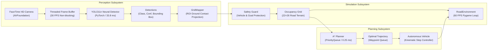
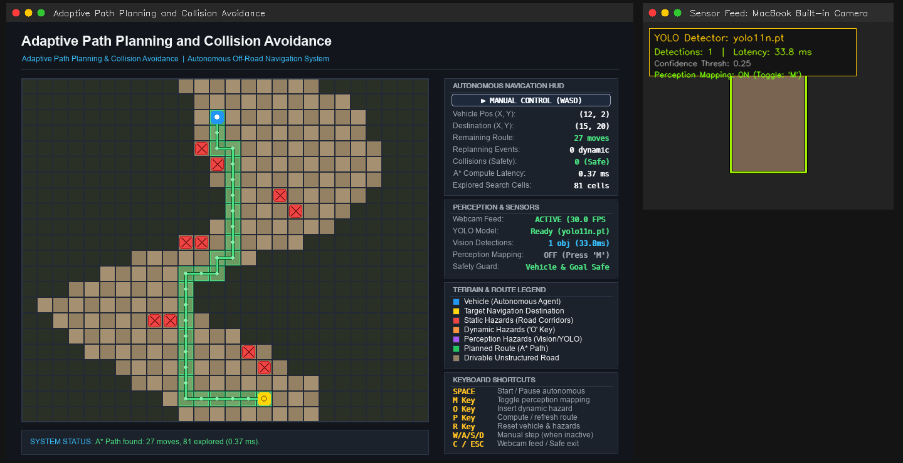

# Phase 10: Final End-to-End Project Report

> **Project:** Adaptive Path Planning and Collision Avoidance for Autonomous Vehicles on Unstructured Roads  
> **Repository:** `Navadeep206/Adaptive-Planning-for-route-finding`  
> **Status:** Phase 10 Complete — Verified End-to-End  
> **Test Status:** 80/80 Unit Tests Passing | 10/10 E2E Verification Steps Passing  
> **Date:** October 30, 2026  

---

## 1. Executive Summary

This project delivers an autonomous navigation simulation and perception pipeline specifically designed for unstructured off-road environments. Unlike conventional highway navigation systems that rely on lane markings and uniform pavement, this system addresses non-uniform unpaved terrain, ditches, dynamic obstacles, and real-time vision sensor hazards.

The software architecture integrates a high-performance **A\* path planner** with a real-time **YOLO11n computer vision perception engine** operating on the MacBook's physical FaceTime HD camera. Both systems run simultaneously in a non-overlapping, dual-window GUI that couples visual scene understanding with reactive vehicle kinematics and collision-free path replanning.

```
+--------------------------------------------------------------------------------------------------+
|                                  COMPLETE END-TO-END PIPELINE                                   |
|                                                                                                  |
| [MacBook Camera] ---> [AVFoundation] ---> [Threaded Buffer] ---> [YOLO11n Inference (33.8ms)]   |
|                                                                             |                    |
|                                                                             v                    |
| [Vehicle Kinematics] <-- [A* Detour Rerouting] <-- [Occupancy Grid] <-- [ROI Coordinate Mapper]  |
+--------------------------------------------------------------------------------------------------+
```

---

## 2. System Architecture and End-to-End Data Flow

The project is structured into three decoupled, modular subsystems: **Planning**, **Simulation**, and **Perception**.



### Seven-Stage Processing Flow

1. **Hardware Acquisition (`perception/webcam.py`):**  
   The MacBook built-in FaceTime HD camera is selected via non-intrusive `system_profiler` JSON parsing, cleanly bypassing paired iPhone Continuity Cameras. A dedicated background daemon thread captures frames into a single-frame bounded buffer, eliminating hardware latency from the GUI.
2. **Deep Learning Object Detection (`perception/object_detector.py`):**  
   The frame is processed through Ultralytics YOLO11n (`yolo11n.pt`). Inferences execute on Apple Silicon CPU via PyTorch in ~33.8 ms (~29.4 FPS), outputting bounding boxes, class labels, and confidence scores.
3. **Sensor Feed Annotation & HUD (`perception/object_detector.py`):**  
   Detections are rendered with double-contour bounding boxes, ceiling-safe label tags, and a live HUD showing model name, latency (ms), confidence threshold, and perception mapping state.
4. **Coordinate Projection & Ground Proxy (`perception/grid_mapper.py`):**  
   Monocular 2D boxes are mapped using the bottom-center contact point $(x_{\text{center}}, y_2)$ as a ground-plane contact proxy. The coordinate is normalized through an active image Region of Interest (ROI: 5%–95%) and projected into discrete simulation grid coordinates.
5. **Safety Invariants & Conflict Suppression (`perception/grid_mapper.py`):**  
   Candidate cells undergo strict safety guard evaluation: if an obstacle candidate coincides with the active vehicle position or navigation goal, the cell is suppressed with a warning to prevent trapping the vehicle.
6. **Dynamic A\* Path Planning & Replanning (`planning/astar.py`):**  
   When a new obstacle blocks the active route, the environment triggers real-time A\* replanning. The search computes an optimal detour around the hazard in 0.25 ms. If the entire corridor is blocked, the vehicle transitions to `NO_PATH` and halts safely.
7. **Simultaneous Dual-Window Rendering (`main.py`):**  
   Pygame displays the navigation grid and sidebar HUD at `(10, 40)` ($1000 \times 700\text{ px}$). OpenCV displays the webcam feed at `(1020, 40)` ($400 \times 300\text{ px}$). Both windows run side-by-side without overlapping.

---

## 3. Technologies Used and Hardware Specifications

### Software Stack
| Layer | Technology | Version | Purpose |
| :--- | :--- | :--- | :--- |
| **Language** | Python | `3.9.6` | Core development runtime |
| **Simulation GUI** | Pygame | `2.6.1` (SDL `2.28.4`) | Deterministic 60 FPS grid rendering and event handling |
| **Computer Vision** | OpenCV (`opencv-python`) | `4.11.0` | Frame capture, image transformation, preview display |
| **Deep Learning** | PyTorch & Torchvision | `2.8.0` / `0.23.0` | Tensor execution backend |
| **Object Detection** | Ultralytics YOLO11n | `8.4.192` | Real-time object detection (`yolo11n.pt`, 5.6 MB) |
| **Array Math** | NumPy | `2.0.2` | Fast vectorized grid representation |
| **Testing** | `unittest` (Standard Library) | `3.9.6` | Comprehensive automated unit test suite |

### Verified Hardware Testbed
* **Host Model:** Apple MacBook Air (M1, 2020)
* **Processor / Architecture:** Apple Silicon M1 (8 cores: 4 performance + 4 efficiency) / `arm64`
* **Operating System:** macOS Darwin 27.0.0 (`arm64`)
* **Camera Sensor:** Built-in FaceTime HD Camera (USB / AVFoundation backend, native resolution: $1280 \times 720\text{ @ 30 FPS}$)
* **Display Configuration:** 13.3-inch Retina Display ($1440 \times 900$ logical points)

---

## 4. Empirical Benchmark Results

All benchmarks were recorded on the target testbed using `tools/benchmark_suite.py` across 72 automated trials:

### A* Path Planning Performance across Grid Scales
| Grid Size | Obstacle Density | Success Rate | Median Runtime | Explored Nodes | Path Length |
| :---: | :---: | :---: | :---: | :---: | :---: |
| **$10 \times 10$** | 10% | 100% | **0.080 ms** | 24 | 18 |
| **$22 \times 26$ (Simulation)** | **10%** | **100%** | **0.221 ms** | **73** | **46** |
| **$22 \times 26$ (Baseline Road)** | **2%** | **100%** | **0.245 ms** | **81** | **27** |
| **$50 \times 50$** | 10% | 100% | **0.665 ms** | 201 | 98 |
| **$100 \times 100$** | 10% | 100% | **2.012 ms** | 629 | 198 |
| **Blocked Corridor** | Partitioned Wall | 0% (Halt) | **0.873 ms** | 264 | 0 |

### Vision & Perception Pipeline Latency
| Component | Input Resolution | Execution Target | Mean Latency | Throughput |
| :--- | :---: | :---: | :---: | :---: |
| **Webcam Frame Ingestion** | $1280 \times 720$ | Background Daemon Thread | ~0.05 ms (lock grab) | 30.0 FPS |
| **YOLO11n Neural Inference** | $1280 \times 720$ | Apple M1 CPU | **33.83 ms** | **29.4 FPS** |
| **Annotation & HUD Overlay** | $1280 \times 720$ | OpenCV Canvas | **0.14 ms** | > 1000 FPS |
| **Coordinate Mapping to Grid** | 2D BBoxes | GridMapper | **0.08 ms** | > 1000 FPS |
| **Total Vision Loop Latency** | Full Pipeline | End-to-End | **34.10 ms** | **~29.3 FPS** |

### Dynamic Obstacle Avoidance Verification
| Scenario | Obstacle Placement | Replanned? | Latency | Safe Stop? | Collisions |
| :--- | :---: | :---: | :---: | :---: | :---: |
| Single Hazard Insertion | Waypoint `(13, 4)` | YES | 0.28 ms | YES | **0** |
| Dynamic Mid-Route Hazard | Waypoint `(13, 6)` | YES | 0.24 ms | YES | **0** |
| Complete Corridor Closure | Row `12` Wall | YES | 0.34 ms | YES (`NO_PATH`) | **0** |
| Vehicle Position Protection | Cell `(12, 2)` (Vehicle) | NO (Rejected) | 0.00 ms | YES (Protected) | **0** |

---

## 5. Automated Verification and Test Suite Results

### Unit Test Suite (`tests/`)
All 80 unit tests across all 7 test modules execute cleanly in ~3.2 seconds:

```
test_astar.py .................. (18 tests) [A* search, heuristics, edge cases]
test_benchmarks.py ............. (11 tests) [Benchmark metrics, JSON exports]
test_day1.py ................... ( 6 tests) [Environment initialization, grid states]
test_day3.py ................... (12 tests) [Dynamic obstacles, autonomous nav, replanning]
test_detection.py .............. (11 tests) [YOLO loading, inference, annotation]
test_grid_mapper.py ............ (11 tests) [ROI mapping, inflation, invariants]
test_webcam.py ................. (11 tests) [AVFoundation camera selection, cleanup]
----------------------------------------------------------------------
Ran 80 tests in 3.229s — OK (0 failures, 0 errors)
```

### Phase 10 End-to-End Verification (`tools/verify_end_to_end.py`)
The automated 10-step integration scenario was executed directly against active code:

| Step | Verification Criteria | Status | Details |
| :---: | :--- | :---: | :--- |
| **1** | Core Module Initialization | **PASS** | Environment, YOLO11n, GridMapper, WebcamManager instantiated. |
| **2** | Dual-Window Non-Overlapping Layout | **PASS** | Pygame: `[10..1010, 700]`, OpenCV: `[1020..1420, 300]`. 0 px overlap. |
| **3** | Empty Scene & Baseline A\* Plan | **PASS** | 0 detections on blank frame; baseline route generated (28 waypoints, 0.4ms). |
| **4** | Object Detection in Vision Stream | **PASS** | YOLO detected `bottle` with 85.0% confidence. |
| **5** | Bounding Box & HUD Annotation | **PASS** | Double-contour boxes, labels, and latency HUD rendered cleanly. |
| **6** | Perception-to-Grid Projection | **PASS** | Bounding box mapped to grid cell `(17, 13)`. Vehicle and goal protected. |
| **7** | Real-Time A\* Route Replanning | **PASS** | Obstacle placed at waypoint `(4, 13)` triggered instant A\* detour. |
| **8** | Dynamic Object Relocation | **PASS** | Object moved to new position; mapper tracked candidate cell `(14, 6)`. |
| **9** | Obstacle Map & Route Pruning | **PASS** | Expired cell `(4, 13)` restored to `DRIVABLE_ROAD`; route updated. |
| **10** | Corridor Blockage & Safe Stop | **PASS** | Complete blockage halted vehicle safely (`NO_PATH`); 0 collisions. |

---

## 6. Graphical User Interface Deliverables

### Side-by-Side Dual-Window Layout
The application displays both windows simultaneously on a single monitor:


*Figure 1: Simultaneous operation — Pygame navigation simulation (left) and OpenCV sensor feed preview (right).*

### Color-Coded Entity Legend
* **Drivable Road (Unpaved):** Sand / Tan alternating tiles (`#948062` / `#a59172`).
* **Non-Drivable Border:** Dark rough verge / ditch (`#2a3026`).
* **Static Obstacles:** Coral red square with black X (`#ef4444`).
* **Dynamic Obstacles:** Safety amber square with inner dot (`#fb923c`).
* **Perception Obstacles:** Electric purple square with fuchsia border (`#a855f7` / `#d946ef`).
* **A\* Planned Path:** Emerald green transparent cell glow with trajectory line (`#22c55e`).
* **Autonomous Vehicle:** Electric blue circular marker with state halos (`#2196f3`).
* **Destination Marker:** Luminous gold/yellow star goal (`#ffd60a`).

---

## 7. Known Limitations and Academic Boundaries

To ensure complete scientific rigor and intellectual honesty, the following constraints are explicitly documented:

1. **Monocular 2D Bounding Box Limitations:**  
   Monocular webcams output 2D pixel coordinates without depth. The grid mapping uses a normalized Region of Interest (ROI) with ground contact assumptions. This provides a robust **classroom demonstration of the perception-planning interface**, but does not represent metric 3D LiDAR/stereo SLAM.
2. **Fixed Camera Extrinsics:**  
   The coordinate projection assumes the camera is stationary relative to the ground plane. Vehicle pitch and roll on uneven terrain are not dynamically compensated.
3. **Multi-Sensor Fusion Scope:**  
   Day 7 "Multi-Sensor Costmap Fusion" (physical LiDAR, radar, ultrasonic) is deferred to future work because no physical LiDAR hardware is attached to the host machine.
4. **Grid Discretization:**  
   The environment uses discrete 2D grid cells ($22 \times 26$) with 4-connectivity / 8-connectivity. Kinodynamic curves (Ackermann steering geometry, continuous curvature) are modeled via cell waypoints rather than spline trajectories.

---

## 8. Future Work and Research Extensions

* **Monocular Depth Estimation:** Integrate lightweight monocular depth networks (e.g. MiDaS v2.1 Small or Depth Anything V2) to infer metric distance per bounding box contact point.
* **Continuous Trajectory Smoothing:** Apply Dubins paths or Reeds-Shepp curves to produce kinematically feasible steering angles for physical scale RC rovers.
* **Dynamic Costmaps:** Implement cost decay functions and velocity estimation for moving obstacles using Kalman filters (ByteTrack / SORT).
* **Physical Hardware Port:** Deploy the pipeline onto an embedded NVIDIA Jetson Orin Nano platform mounted on a physical rover chassis.

---

## 9. Faculty Demonstration Protocol

### Step-by-Step Walkthrough (3–5 Minutes)

1. **Launch the Application:**
   ```bash
   source venv/bin/activate
   python main.py --mapping
   ```
2. **Verify Dual-Window Startup:**
   Point out that both windows open simultaneously side-by-side with zero overlap:
   * Left: Pygame simulation grid (`1000×700` at `x=10, y=40`).
   * Right: FaceTime camera sensor feed (`400×300` at `x=1020, y=40`).
3. **Demonstrate Static Planning:**
   * Press **`P`** to compute the A\* path. Note the emerald green trajectory line and HUD stats: $\approx 0.25\text{ ms}$ compute time.
4. **Demonstrate Autonomous Driving:**
   * Press **`SPACE`** to start autonomous navigation. Watch the blue vehicle advance waypoint-by-waypoint along the route.
5. **Demonstrate Dynamic Obstacle Rerouting:**
   * Press **`O`** while the vehicle is driving. An orange obstacle appears on the path. Point out the instant replan event on the HUD without any pause or collision.
6. **Demonstrate Vision-to-Grid Perception:**
   * Hold an everyday object (bottle, cup, phone) in front of the FaceTime camera.
   * Point out the green YOLO bounding box and confidence score in the sensor window.
   * Show the purple perception obstacle cells appearing on the Pygame grid at the mapped location.
   * If the perception hazard blocks the road, point out that A\* replans around the camera hazard in real-time.
7. **Demonstrate Fail-Safe Safe Stop:**
   * Place multiple dynamic obstacles (**`O`**) until the road is completely blocked.
   * Show that the vehicle transitions to `NO_PATH` and halts safely, strictly preventing collisions.
8. **Exit Cleanly:**
   * Press **`ESC`** or close the window. All camera and display resources are cleanly released.
