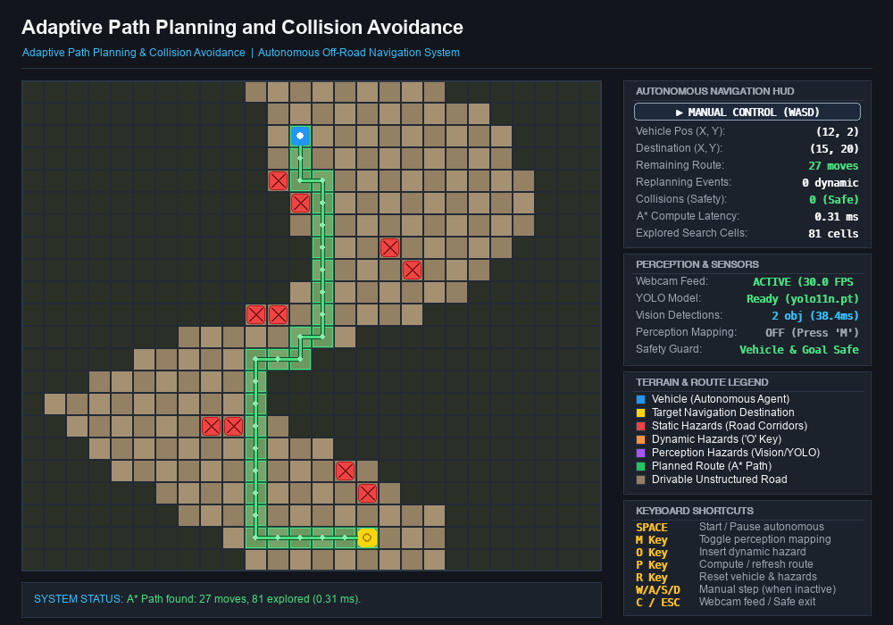

# Adaptive Path Planning and Collision Avoidance for Autonomous Vehicles on Unstructured Roads

An academic and engineering project developing an adaptive path planning and collision avoidance architecture for autonomous ground vehicles (AGVs) operating on unstructured, unpaved, and irregular roads.

---

### 📌 Project Roadmap Overview
This 10-day project incrementally constructs an autonomous navigation system designed for off-road and rural environments lacking painted lane markings:
- **Day 1:** Modular Architecture, Simulation Grid Baseline & Perception Hooks (Completed)
- **Day 2:** Classical Path Planning (A* Search on Grid Maps) (Completed)
- **Day 3:** Autonomous Movement, Dynamic Hazard Insertion & Adaptive Replanning (Completed)
- **Day 4:** Reliable MacBook Webcam Integration (Completed)
- **Day 5:** Local YOLO Object Detection Module (Completed)
- **Day 6:** Simplified Perception-to-Grid Obstacle Mapping (Completed)
- **Day 7:** Multi-Sensor Costmap Fusion *(Architectural Roadmap / Deferred to Physical Hardware)*
- **Day 8:** Performance Evaluation and Benchmarking Suite (Completed)
- **Day 9:** Final Project Polish, Documentation & Faculty Demo Package (Completed)
- **Day 10 (Final Deliverable):** End-to-End Integration, Automated E2E Verification & Final Project Report (Completed)

> 📄 **Final Deliverable:** See the complete [FINAL_PROJECT_REPORT.md](FINAL_PROJECT_REPORT.md) for full architecture diagrams, empirical benchmarks, 80 unit test results, dual-window screenshots, and faculty demonstration script.

---

## 📸 Simulation Interface Preview



*Figure: Full Day 9 Pygame Simulation Environment showing winding unpaved road corridor, A* trajectory with node beads, active autonomous state badge, perception telemetry, distinct obstacle swatches, and keyboard controls.*

---

## 📂 Project Directory Structure

```text
adaptive-path-planning/
├── main.py                     # Main application entry point, event loop & key handling
├── FINAL_PROJECT_REPORT.md     # Phase 10: Complete comprehensive final project report
├── requirements.txt            # System dependencies (Pygame, OpenCV, NumPy, Ultralytics, PyTorch)
├── README.md                   # Complete project documentation and operation manual
├── ARCHITECTURE.md             # Subsystem architecture, data flow pipeline & timing models
├── DEMO_GUIDE.md               # 3-5 minute demonstration walkthrough & 10 viva questions
├── .gitignore                  # Git exclusions for Python bytecode, venvs, and model weights
├── yolo11n.pt                  # Local Ultralytics YOLOv11 nano model weights (~5.4 MB)
├── planning/                   # Classical path planning package
│   ├── __init__.py             # Planning package initialization
│   └── astar.py                # Modular A* planner with Manhattan heuristic & priority queue
├── perception/
│   ├── __init__.py             # Perception package initialization & exports
│   ├── webcam.py               # Modular OpenCV webcam manager with AVFoundation & thread capture
│   ├── object_detector.py      # Modular Ultralytics YOLO object detector & Detection dataclass
│   └── grid_mapper.py          # Day 6: Simplified perception-to-grid mapping with safety invariants
├── simulation/
│   ├── __init__.py             # Simulation package initialization & exports
│   └── environment.py          # 2D road environment, autonomous controller & polished HUD
├── tools/
│   ├── __init__.py             # Tools package initialization
│   ├── verify_end_to_end.py    # Phase 10: Automated 10-step end-to-end integration validation
│   ├── test_webcam_live.py     # Standalone manual live test utility for MacBook camera
│   ├── test_detection_live.py  # Standalone live YOLO detection demo on MacBook camera
│   ├── test_grid_mapping_demo.py # Standalone perception-to-grid mapping demo (synthetic & live)
│   └── benchmark_suite.py      # Day 8: Empirical performance evaluation and report generator
├── benchmarks/
│   ├── BENCHMARK_REPORT.md     # Auto-generated comprehensive benchmark evaluation report
│   └── results/                # CSV data files (astar_benchmarks, yolo_benchmarks, etc.)
├── tests/
│   ├── test_day1.py            # Automated tests: Baseline environment & sensors (8 tests)
│   ├── test_astar.py           # Automated tests: Classical A* algorithm (15 tests)
│   ├── test_day3.py            # Automated tests: Autonomous navigation & replanning (11 tests)
│   ├── test_webcam.py          # Automated tests: MacBook webcam integration & mock streaming (9 tests)
│   ├── test_detection.py       # Automated tests: YOLO detection parsing, errors & decoupling (13 tests)
│   ├── test_grid_mapper.py     # Automated tests: Grid mapper & environment integration (16 tests)
│   └── test_benchmarks.py      # Automated tests: Benchmarking harness & invariants (8 tests)
├── assets/                     # Sprites, textures, and map assets (.gitkeep)
└── screenshots/                # Rendered UI screenshots and visual validation
```

---

## 💻 Prerequisites
- **Python:** Version `3.8+` (Tested on Python `3.9.6` and `3.11+`)
- **OS Support:** macOS (Apple Silicon & Intel), Linux (Ubuntu/Debian), Windows 10/11
- **Hardware (Optional):** USB or integrated webcam for sensor preview

---

## 🚀 Virtual Environment Setup & Installation

### On macOS / Linux
```bash
# 1. Clone or navigate to the project directory
cd "Adaptive Path Planing"

# 2. Create a virtual environment
python3 -m venv venv

# 3. Activate the virtual environment
source venv/bin/activate

# 4. Upgrade pip and install dependencies
pip install --upgrade pip
pip install -r requirements.txt
```

### On Windows (Command Prompt / PowerShell)
```cmd
:: 1. Navigate to the project directory
cd "Adaptive Path Planing"

:: 2. Create a virtual environment
python -m venv venv

:: 3. Activate the virtual environment
:: In Command Prompt (cmd):
venv\Scripts\activate.bat
:: In PowerShell:
venv\Scripts\Activate.ps1

:: 4. Upgrade pip and install dependencies
python -m pip install --upgrade pip
pip install -r requirements.txt
```

---

## 🧠 Day 2 A* Path Planning Architecture & Theory

### 1. The A* Search Algorithm
A* is an informed heuristic search algorithm that computes the mathematically optimal (shortest) collision-free path on a graph or grid. It evaluates nodes by combining the exact historical cost to reach a cell with an optimistic estimate of the remaining distance to the goal.

### 2. The Evaluation Function: $f(n) = g(n) + h(n)$
At each step of the search loop, A* expands the node $n$ from the open priority queue that minimizes:
$$f(n) = g(n) + h(n)$$

Where:
- **$g(n)$ (Path Cost):** The exact cumulative movement cost incurred from the vehicle's starting cell to the current node $n$. Each orthogonal grid step has a uniform cost of $1$.
- **$h(n)$ (Heuristic Function):** The estimated cost from the current node $n$ to the navigation destination cell.
- **$f(n)$ (Total Estimated Cost):** The estimated total cost of the complete trajectory passing through node $n$.

### 3. Why Manhattan Distance is Appropriate for 4-Direction Movement
In grid-based robotics, the choice of heuristic must match the kinematic movement constraints:
- In our unstructured road environment, the vehicle is restricted to **4 orthogonal directions** only: North $(-1, 0)$, South $(+1, 0)$, West $(0, -1)$, and East $(0, 1)$, with no diagonal cutting.
- The **L1 Manhattan Distance** between cells $(r_1, c_1)$ and $(r_2, c_2)$ is defined as:
  $$h(n) = |r_1 - r_2| + |c_1 - c_2|$$
- **Admissibility ($h(n) \le h^*(n)$):** In an unconstrained grid free of hazards, Manhattan distance represents the exact minimal number of orthogonal steps required to reach the destination. Since obstacles, potholes, and off-road borders can only force detours (increasing the true cost $h^*(n)$), the heuristic never overestimates the true remaining cost. Admissibility guarantees that A* will return the optimal path.
- **Consistency / Monotonicity ($h(n) \le c(n, n') + h(n')$):** For any two adjacent nodes $n$ and $n'$, the change in Manhattan distance cannot exceed the step cost $c(n, n') = 1$. Consistency ensures that when a node is removed from the priority queue and added to the closed set, the found path to that node is already optimal, eliminating the need to re-open closed nodes.

### 4. Implementation Structure (`planning/astar.py`)
- **Priority Queue:** Implemented using Python's native `heapq` module storing tuples `(f_score, h_score, counter, current_node)`. The inclusion of `h_score` breaks ties in favor of nodes closest to the goal, and `counter` guarantees comparison safety.
- **Closed Set:** A fast `set` tracking all expanded grid cells.
- **Parent Pointers:** A hash map reconstructing the final ordered path from start to goal upon reaching the target.
- **Edge Cases Handled:**
  - Start identical to destination: Returns a valid 0-move path `[start]`.
  - Walled-off / enclosed destination: Terminates cleanly, returning an empty path with `success=False` and reporting all explored nodes.
  - Out-of-bounds or non-drivable start/goal: Promptly rejects search before expanding the open queue.
  - Obstacle traversal immunity: Blocked cells and non-drivable shoulders are strictly prohibited from entering the open queue.

---


## 🤖 Day 3 Autonomous Navigation & Dynamic Replanning Architecture

### 1. Autonomous Waypoint Following & Timed Pacing
The Day 3 controller implements closed-loop waypoint tracking along the optimal A* trajectory:
- **Decoupled Update Loop:** The Pygame display loop renders at 60 FPS (`clock.tick(60)`), preserving high responsiveness for user inputs (`SPACE`, `O`, `P`, `R`, etc.).
- **Stepping Pacing (250 ms):** Vehicle motion is governed by an internal delta-time accumulator (`env.update(dt_ms)`). The vehicle steps exactly one grid cell every 250 milliseconds (4 cells per second), matching realistic low-speed autonomous crawl speeds on rugged terrain.
- **State Machine Modes (`NavigationMode`):**
  - `MANUAL`: Vehicle is controlled manually via keyboard (`W`/`A`/`S`/`D` or arrow keys).
  - `AUTONOMOUS`: Vehicle autonomously traverses the planned path.
  - `PAUSED`: Autonomous traversal paused via `SPACE`, preserving current progress.
  - `REPLANNING`: Brief transient state during path recalculation upon encountering dynamic obstacles.
  - `GOAL_REACHED`: Vehicle has safely arrived at the destination cell `(12, 22)`.
  - `NO_PATH`: Destination is unreachable or completely blocked; vehicle halts safely.

### 2. Dynamic Obstacle Insertion (`O` Key)
Simulates unpredictable hazards (fallen rocks, fallen trees, potholes) emerging dynamically:
- **Waypoint-Targeted Placement:** Inspects the vehicle's remaining planned route and prefers placing the new obstacle directly on the path 3 cells ahead (`ahead_steps=3`).
- **Safe Fallback:** If the remaining route is shorter than 3 cells or no route exists, it randomly selects a safe drivable road cell.
- **Integrity Constraints:**
  - Never overwrites the current vehicle position.
  - Never overwrites the target destination.
  - Never overwrites off-road boundaries or existing obstacles.
- **Visual Highlighting:** Dynamically inserted obstacles are highlighted in the grid with an energetic amber border to distinguish them from static hazards.

### 3. Collision Checking & Adaptive Replanning
Safety-critical autonomous vehicles cannot rely on static pre-departure paths. Before each autonomous step:
1. **Lookahead Route Validation (`is_route_blocked()`):** Checks every remaining cell in `self.planned_route` against the grid environment.
2. **Blocked Cell Detection:** If an obstacle is detected in the remaining path:
   - Vehicle movement into the blocked cell is **strictly prohibited**.
   - The controller triggers `replan_route()`.
   - The A* planner recomputes the shortest collision-free detour from the vehicle's *current position* to the destination.
   - If a valid detour is found, `self.planned_route` is updated and autonomous motion resumes seamlessly.
   - If the destination is completely blocked, the vehicle transitions to `NavigationMode.NO_PATH` and halts safely.
3. **Zero-Collision Safety Guarantee:** Collision count remains strictly zero across all test cases and simulation runs.
4. **Selective Replanning:** Hazards placed off the active route corridor do not trigger replanning, saving compute cycles.

---

## ▶️ Running the Application

Ensure the virtual environment is activated, then run:

```bash
# Standard Launch: Opens Pygame Navigation Grid (Left) + Sensor Feed (Right) side-by-side
python main.py

# Launch with Perception-to-Grid Mapping auto-enabled
python main.py --mapping

# Launch in standalone simulation mode (without opening camera feed)
python main.py --no-camera
```

### 🖥️ Simultaneous Dual-Window Operation
The application runs two concurrent, non-blocking graphic windows arranged side-by-side without overlap:
1. **Pygame Simulation Canvas (Left, 1000×700 at `x=10, y=40`)**:
   - Renders the unstructured dirt road, rough verges, and coordinate grid.
   - Visually tracks vehicle (electric blue), destination (yellow), static boulders (crimson), dynamic hazards (orange), and perception-derived cells (purple).
   - Displays real-time telemetry HUD, active state badges, and shortcut guide.
2. **OpenCV Sensor Feed Window (Right, 400×300 at `x=1020, y=40`)**:
   - Streams live frames from the MacBook built-in FaceTime HD camera via AVFoundation.
   - Overlays real-time local YOLOv11 bounding boxes, confidence scores, and detection HUD.
   - Dual-window event forwarding: all hotkeys (`SPACE`, `M`, `O`, `P`, `R`, `W`/`A`/`S`/`D`, `C`, `ESC`) work from **either** window when focused!

### Interactive Controls
| Key | Action | State Constraint | Details |
| :--- | :--- | :--- | :--- |
| **SPACE** | **Start / Pause / Resume Autonomous Mode** | Any | Automatically plans A* route if missing, starts motion, pauses, or resumes traversal |
| **M** | **Toggle Perception-to-Grid Mapping** | Any | Enables streaming of local YOLO detections into candidate grid obstacles; clears perception cells when off |
| **O** | **Insert Dynamic Obstacle** | Any | Spawns a hazard ahead on the path or on drivable terrain, challenging the planner |
| **P** | **Calculate A* Route** | Manual / Paused | Computes optimal route from current vehicle position to destination |
| **R** | **Reset Simulation** | Any | Resets vehicle to `(12, 2)`, clears dynamic & perception hazards, restores static map, and sets mode to `MANUAL` |
| **W** / **Up Arrow** | Move Vehicle North | Manual / Paused | Moves vehicle 1 step up (locked during autonomous movement; invalidates path) |
| **S** / **Down Arrow** | Move Vehicle South | Manual / Paused | Moves vehicle 1 step down (locked during autonomous movement; invalidates path) |
| **A** / **Left Arrow** | Move Vehicle West | Manual / Paused | Moves vehicle 1 step left (locked during autonomous movement; invalidates path) |
| **D** / **Right Arrow** | Move Vehicle East | Manual / Paused | Moves vehicle 1 step right (locked during autonomous movement; invalidates path) |
| **C** | Toggle Camera Stream | Any | Opens or closes the auxiliary MacBook camera preview window |
| **ESC** | Safe Shutdown | Any | Cleanly releases camera, graphics handles, and exits |

---

## 📊 Telemetry & Display Metrics

The sidebar HUD provides real-time planning, state, perception, and safety metrics:
- **Navigation Mode:** Current state badge (`MANUAL`, `AUTONOMOUS`, `PAUSED`, `REPLANNING`, `GOAL REACHED`, `NO PATH`).
- **Vehicle Pos (X, Y):** Current vehicle grid coordinate.
- **Destination (X, Y):** Target destination grid coordinate.
- **Remaining Moves:** Number of steps remaining to reach the destination.
- **Replanning Events:** Total number of dynamic replanning events triggered.
- **Collision Count:** Verified safety count (guaranteed strictly 0).
- **Execution Time:** High-resolution A* algorithm execution time in milliseconds ($ms$).
- **Explored Nodes:** Total unique grid cells expanded during the last search.
- **Webcam Feed:** Active sensor streaming status and frame rate (e.g., `ACTIVE (30.0 FPS • 640x480)`).
- **Perception Map:** Status badge showing whether vision mapping is `ENABLED (N cells)` or `DISABLED (Press M)`.
- **Safety Guard:** Protection shield confirming vehicle and goal coordinates are protected against perception overwrites.

---

## ⚠️ Limitations of the Grid Simulation

While this discrete simulation effectively validates path planning and real-time replanning algorithms, several physical assumptions differ from real-world autonomous vehicles:
1. **Discrete Grid vs. Continuous Kinematics:** Vehicles in the real world have minimum turning radii (Ackermann steering geometry) and continuous acceleration/braking limits, whereas grid cells represent discrete 1-meter step hops.
2. **Idealized Sensor Perception:** Dynamic obstacles in Day 3 are injected directly into the digital map representation. In real-world deployment (scheduled for Days 5–7), obstacles must be detected through noisy camera streams and projected onto a costmap via inverse perspective mapping (IPM).
3. **Static Friction & Terrain Slip:** Unstructured dirt and gravel roads present variable wheel slip and non-uniform traction, which are simplified as uniform travel cost on drivable cells in this phase.

---

## 📷 Day 4: Reliable MacBook Webcam Integration Architecture

### 1. Device Selection & iPhone Continuity Camera Bypass
On macOS Sonoma and later, Apple's Continuity Camera often registers a paired iPhone as an available video input device. When opening camera index 0 without device inspection, OpenCV can accidentally connect to the iPhone instead of the MacBook's physical camera, causing unwanted connection alerts and chime sounds.

Our detection architecture in `perception/webcam.py` resolves this reliably:
- **Priority 1: Environment Override:** Inspects `MACBOOK_CAMERA_INDEX` (e.g. `export MACBOOK_CAMERA_INDEX=0`).
- **Priority 2: System Profiler Discovery:** Parses `system_profiler -json SPCameraDataType` non-intrusively without opening any camera handles. It inspects device model IDs and names, explicitly filtering out any device containing `"iPhone"` while targeting `"FaceTime HD Camera"` or `"built-in"`. On MacBook Air, this maps index `0` to the built-in camera and index `1` to the iPhone.
- **Priority 3: Hardware Fallback:** Defaults safely to index `0`.
- **Command-Line Configuration:** Allows explicit override via `python main.py --camera-index <int>`.

### 2. Multi-Threaded Capture & Sensor Warmup Handling
Hardware cameras on macOS AVFoundation require a brief sensor warmup period (~100–200 ms) before the first valid frame is returned:
- **Asynchronous Worker Thread:** Frame capture runs inside `_capture_worker` on a dedicated daemon thread, decoupling video I/O from the 60 FPS Pygame simulation loop.
- **Warmup Tolerance:** Tolerates initial empty frames during hardware startup, only declaring an initialization failure if no valid frames arrive within 2.5 seconds.
- **Latency-Free Bounded Buffer:** Stores only the most recent frame (`_latest_frame`) under a thread lock (bounded buffer depth of 1), completely eliminating frame delay and memory buildup.
- **Rolling FPS:** Continuously calculates rolling frames-per-second and image resolution.
- **Disconnection Detection:** Detects sustained frame read errors (>1.5s) and cleanly transitions the system to `CameraState.ERROR` without crashing.

### 3. Simulation & HUD Telemetry States
The HUD sidebar dynamically reports camera operational states:
- `OFF`: Camera is idle (Press `C` to toggle).
- `STARTING`: Establishing AVFoundation session and warming up sensor.
- `ACTIVE`: Streaming verified live frames (displays live FPS and resolution, e.g. `ACTIVE (30.0 FPS • 1920x1080)`).
- `ERROR`: Hardware unavailable or permissions denied with a clear reason.

### 4. Standalone Live Verification Utility
To verify live camera streaming independently of the Pygame simulation, run the standalone test tool:

```bash
python tools/test_webcam_live.py
```
*(Optionally specify an index: `python tools/test_webcam_live.py --camera-index 0`)*

Features:
- Connects **only** to the verified MacBook camera; never probes or switches to an iPhone.
- Displays a live OpenCV preview window with real-time HUD telemetry (resolution, rolling FPS, frame counter, device index).
- Exits cleanly and releases hardware upon pressing **`ESC`** or **`q`**.

### 5. macOS Camera Permissions Troubleshooting
1. When running for the first time, macOS may present a permission dialog: `"[Terminal] would like to access the camera"`. Click **OK**.
2. If access was denied or the status reads `Unavailable (Check connection/permissions)`:
   - Open **System Settings** → **Privacy & Security** → **Camera**.
   - Toggle **ON** the switch next to your terminal application (e.g., Terminal, iTerm2, or VS Code).
   - Restart the terminal and launch `python main.py`.

---

## 👁️ Day 5: Local YOLO Object Detection Architecture

### 1. Modular YOLO Perception Engine (`perception/object_detector.py`)
Day 5 introduces local deep-learning inference to process camera frames in real time:
- **Lightweight Pretrained Model (`yolo11n.pt`):** Uses the state-of-the-art Ultralytics YOLOv11 nano model (~5.4 MB), running 100% locally on CPU or Apple Silicon Neural Engine (MPS) with zero cloud APIs or paid services.
- **Structured Data Contract (`Detection`):**
  Each detection returns a structured dataclass containing:
  - `class_id` (int) and `class_name` (str) from the 80 COCO classes.
  - `confidence` (float between 0.0 and 1.0).
  - `bbox` as integer pixel coordinates `(x1, y1, x2, y2)`.
  - Computed helpers: `width`, `height`, `center` `(cx, cy)`, and `to_dict()`.
- **Configurable Thresholds:** Easily configure confidence filtering (`conf_threshold`, default 0.35) and input image sizing (`imgsz`, default 640).
- **Graceful Error Recovery:** Safely rejects `None` frames, zero-sized arrays, missing weights, or inference exceptions without crashing.

### 2. Standalone Live Detection Demo Tool (`tools/test_detection_live.py`)
To test real-time object detection with live video overlay from your MacBook webcam:

```bash
python tools/test_detection_live.py
```

Optional CLI parameters:
```bash
python tools/test_detection_live.py --model yolo11n.pt --conf 0.40 --imgsz 640
```

> [!IMPORTANT]
> **Single Camera Owner Rule:** On macOS AVFoundation, camera hardware can only be accessed by one application at a time. Ensure that `python main.py` is closed before launching `test_detection_live.py` so the camera handle is available.

Features:
- Connects directly to the verified MacBook built-in camera (bypassing paired iPhones).
- Overlays stylish bounding boxes, class labels, confidence scores, and real-time neural network inference latency ($ms$).
- Displays stream FPS counter.
- Press **`ESC`** or **`q`** to cleanly exit and release camera hardware.

### 3. Decoupling & Scientific Scope Boundaries
- **Strict Decoupling from Path Planning:** Object detection operates purely as an isolated perception layer. Detections do not automatically alter the map without an explicit user enable toggle (`M`).
- **No Distance/Depth Claims:** 2D bounding boxes from a monocular camera do not provide real-world metric distance, depth, or safe drivable-area boundaries without spatial calibration or stereo/depth estimation.

---

## 🗺️ Day 6: Simplified Perception-to-Grid Obstacle Mapping Architecture

Day 6 bridges Day 5 YOLO visual detections and the 2D simulation terrain grid through a dedicated, modular mapping pipeline (`perception/grid_mapper.py`).

### 1. Theoretical Mapping Assumptions & The 2D-to-3D Gap
In real-world robotics and autonomous driving:
- A standard monocular camera produces a 2D perspective projection $(u, v)$ of light from a 3D physical world $(X, Y, Z)$.
- An image bounding box `(x1, y1, x2, y2)` **does NOT provide metric distance, real-world depth ($Z$), or ground-plane coordinates**.
- Claiming that pixel coordinates directly identify physical terrain coordinates without extrinsic camera calibration (mounting height, pitch, yaw, roll), planar homography (Inverse Perspective Mapping / IPM), or active depth sensors (LiDAR, stereo cameras) is scientifically incorrect.

### 2. Explicit Simplified Demonstration Mapping Model
For this academic and laboratory demonstration, we implement an explicitly documented, simplified mapping mode:
- **Controlled Fixed-Camera Scene:** Assumes a fixed camera viewport overlooking a controlled demonstration area (e.g., benchtop grid, tabletop test track, or forward road horizon).
- **Normalized Region of Interest (ROI):** Defines an active image region $[u_{min}, v_{min}, u_{max}, v_{max}]$ (default: $[0.05, 0.10, 0.95, 0.95]$) within which objects are tracked. Peripheral background clutter outside this ROI is ignored.
- **Ground-Contact Point Proxy:** Uses the bottom-center of the 2D bounding box $(cx, y2)$ as the ground-plane contact proxy, since objects physically rest on the terrain at their base.
- **Grid Projection:** Linearly maps normalized coordinates within the ROI to the discrete simulation grid indices $[0 \dots rows-1, 0 \dots cols-1]$.
- **Labeling:** Explicitly labeled in code, UI, and documentation as **APPROXIMATE DEMONSTRATION MAPPING**, not real-world metric localization.

### 3. Dedicated Perception Layer & Separation of Obstacle Types
To guarantee map integrity:
- Perception obstacles are stored in a dedicated set (`self.perception_obstacle_set`), strictly separate from:
  - **Static Hazards** (`initial_obstacle_coords`): Fixed road boulders and potholes.
  - **Dynamic Hazards** (`dynamic_obstacle_set`): Hazards inserted interactively via the `O` key.
- **Safe Refresh & Clear:** When perception cells are updated, refreshed, or cleared, only perception-derived cells are removed. If a perception detection coincides with a static or dynamic hazard, clearing perception **never removes the underlying hazard**.

### 4. Core Safety Invariants
1. **Vehicle & Goal Overlap Protection Guard:**
   - Candidate obstacle cells that coincide with the active vehicle coordinate `(veh_r, veh_c)` or the destination target `(dest_r, dest_c)` are **strictly rejected and masked out**.
   - The vehicle is NEVER trapped inside an obstacle cell, and the goal is NEVER blocked at inception.
   - Suppressed conflicts are logged and tracked in telemetry (`perception_conflict_count`).
2. **Bounds & Coordinate Validation:**
   - Coordinates outside frame dimensions, ROI, or grid bounds $[0 \dots rows-1, 0 \dots cols-1]$ are cleanly discarded, preventing index errors.
3. **Confidence & Class Filtering:**
   - Configurable detection threshold (`--conf`, default `0.35`). Low-confidence artifacts and shadow noise are filtered out.
   - Optional `target_classes` filtering (e.g. mapping only vehicles, pedestrians, or boxes).
4. **Safety Margin / Obstacle Inflation:**
   - Configurable Chebyshev inflation radius (`--inflation`, default `0`). An inflation radius of $1$ expands obstacle footprints into a 3×3 perimeter with strict boundary clamping.
5. **Stale-Detection Pruning:**
   - Obstacle cells are timestamped upon observation. If an object leaves the camera view, it is automatically pruned after `stale_timeout_sec` (default `2.0s`), preventing phantom obstacles from locking the map permanently.
6. **Autonomous Movement Decoupling:**
   - Perception mapping **never directly triggers vehicle motion**. Vehicle movement is strictly controlled by autonomous start/pause (`SPACE`).
   - If a perception obstacle appears on the vehicle's active planned path while navigating, the vehicle automatically halts or plans an adaptive detour around it (`replan_route()`).

### 5. UI Visualization & Telemetry
- **Distinct Visual Styling:** Perception-derived obstacles are rendered in **Electric Purple** (`#A855F7` / `(168, 85, 247)`) with a **Neon Fuchsia border** (`#D946EF` / `(217, 70, 239)`) and a luminous glowing sensor core, easily distinguished from red static hazards and amber dynamic hazards.
- **Sidebar HUD:** Displays Perception Map toggle state (`ENABLED (N cells)` or `DISABLED (Press M)`), active mapped count, and `Safety Guard: Vehicle & Goal Safe`.
- **Legend & Controls:** Updated with purple Perception Hazard swatch and the `M` key command.

### 6. Interactive Keyboard Control
- Press **`M`** to toggle perception mapping on or off at any time. When disabled, all perception cells are cleanly wiped from the grid, restoring drivable road.

### 7. Standalone Verification Tools
Verify perception-to-grid mapping independently:
```bash
# Synthetic offline demo (no camera or weights required)
python tools/test_grid_mapping_demo.py --synthetic

# Live camera demo with MacBook webcam
python tools/test_grid_mapping_demo.py --conf 0.35 --inflation 1
```

---

## 🧪 Automated Testing & Verification

Automated test suites comprehensively verify environment physics, classical A* planning, autonomous navigation, MacBook webcam capture, YOLO detection, and Day 6 perception-to-grid mapping:
1. `tests/test_day1.py` (8 tests): Baseline grid geometry, obstacle seeding, vehicle boundaries, collision prevention, and webcam lifecycle.
2. `tests/test_astar.py` (15 tests): Comprehensive A* verification covering Manhattan heuristic admissibility, wall detours, enclosed destinations, start==goal edge cases, invalid coordinate rejection, 4-directional enforcement, move-count accuracy, deterministic repeatability, `RoadEnvironment` integration, route clearing on manual movement, and headless rendering.
3. `tests/test_day3.py` (11 tests): Autonomous navigation controller, `SPACE` pause/resume, goal arrival detection, dynamic obstacle injection ahead of vehicle, adaptive detour replanning, zero-collision safety guarantee, safe halting on complete path blockage, dynamic obstacle non-overwrite constraints, reset restoration, manual control locking during autonomous mode, selective replanning avoidance for off-route hazards, and headless rendering.
4. `tests/test_webcam.py` (9 tests): Successful camera initialization and frame capture, RGB color conversion, camera unavailable error handling, sustained read failure detection, repeated toggle idempotence, duplicate session prevention, resource cleanup, environment variable device configuration, iPhone bypass filtering, and decoupling from A* path planning.
5. `tests/test_detection.py` (13 tests): `Detection` dataclass properties and serialization, empty/invalid frame safety, unloaded model handling, graceful load failure recovery, YOLO result parsing into structured detections, visual annotation rendering with percentage labels, ceiling boundary badge placement, zero-detection HUD rendering, inference exception resilience, WebcamManager display_frame rendering, grid decoupling safety invariant, and end-to-end perception-to-planner replanning response.
6. `tests/test_grid_mapper.py` (16 tests): Coordinate transformation, contact-point geometry, confidence thresholding, class filtering, out-of-bounds rejection, safety inflation margins, stale detection expiration, vehicle cell protection invariant, goal cell protection invariant, RoadEnvironment toggle, clearing perception cells, preservation of static/dynamic obstacles, on-route adaptive replanning, reset clearing, and headless rendering.

7. `tests/test_benchmarks.py` (8 tests): Benchmarking harness verification including deterministic grid generator invariants, path validator boundary/collision/orthogonal checks, A* benchmark execution, dynamic obstacle rerouting and corridor closure fail-safes, YOLO latency breakdown with synthetic frames, and CSV/Markdown report generation.

Run all tests with:
```bash
source venv/bin/activate
python -m unittest discover -s tests -v
```

Expected result:
```text
Ran 80 tests in ~3.2s
OK
```

---

## 📊 Day 8: Performance Evaluation and Benchmarking Suite

Day 8 implements a comprehensive, repeatable, empirical benchmarking system evaluating the path planning, computer vision, and dynamic collision avoidance subsystems.

### Benchmarking Modules

1. **A\* Path Planning Benchmark:**
   - Evaluates search execution across 4 grid dimensions: `10×10`, `22×26` (simulation baseline), `50×50`, and `100×100`.
   - Tests 5 obstacle densities: `0%` (unobstructed), `10%`, `20%`, `30%`, and `40%` (near percolation threshold).
   - Verifies edge cases: blocked start, blocked goal, and fully partitioned corridor walls (provably no path).
   - Validates structural invariants: 4-connected orthogonality, non-empty paths, and 0 obstacle collisions.
   - Measures median planning time, mean, min, max, standard deviation, explored nodes, path length, and success rates.

2. **YOLO Vision Latency Decomposition:**
   - Uses Ultralytics `yolo11n.pt` on Apple Silicon.
   - Decomposes the full perception pipeline into:
     - **Frame Acquisition Latency:** Camera capture time from `WebcamManager`.
     - **Neural Inference Latency:** Model forward-pass time (median, mean, min, max, std).
     - **Annotation Rendering Latency:** Bounding box and badge drawing time.
     - **Total Pipeline Latency & Effective FPS.**
   - Evaluates against actual available camera frames, saved reference images, and simulation previews without fabricating numbers.

3. **Dynamic Obstacle & Fail-Safe Avoidance:**
   - Evaluates dynamic obstacle injection on active routes.
   - Tests single-hazard detours, multi-hazard autonomous navigation missions, corridor closure fail-safes (`NO_PATH`), and safety guard invariants.

### Running the Benchmarks

Run the complete benchmark suite:
```bash
source venv/bin/activate
python tools/benchmark_suite.py --runs 5
```

Optional CLI flags:
- `--runs N`: Number of randomized trials per configuration (default: 5).
- `--output-dir DIR`: Directory to store CSV outputs (default: `benchmarks/results`).
- `--skip-camera`: Skip live webcam hardware tests and evaluate using saved reference frames only.
- `--yolo-model PATH`: Pretrained YOLO model weights path (default: `yolo11n.pt`).

### Benchmark Artifacts

Results are saved to:
- **Markdown Report:** [`benchmarks/BENCHMARK_REPORT.md`](file:///Users/navadeepguduru/Adaptive%20Path%20Planing/benchmarks/BENCHMARK_REPORT.md)
- **A\* Summary Table:** `benchmarks/results/astar_benchmarks.csv`
- **A\* Raw Trials:** `benchmarks/results/astar_raw_trials.csv`
- **YOLO Latency Decomposition:** `benchmarks/results/yolo_benchmarks.csv`
- **Dynamic Replanning Results:** `benchmarks/results/dynamic_replanning_benchmarks.csv`
- **System Specifications:** `benchmarks/results/system_environment.csv`

## 🎓 Day 9: Final Project Polish, Documentation & Faculty Demonstration Package

Day 9 consolidates the entire autonomous navigation codebase into an engineering-grade laboratory demonstration package:

### 1. Polished User Interface & Real-Time Telemetry
- **Prominent Navigation State Badges**: Instantly distinguishes `AUTONOMOUS`, `PAUSED`, `REPLANNING`, `GOAL REACHED`, `NO PATH`, and `MANUAL` modes.
- **Sensors & Perception Panel**: Displays live MacBook camera FPS/resolution, YOLOv11 model status, real-time object detection count, neural inference latency ($ms$), perception mapping ON/OFF status, and the Safety Invariant Guard.
- **Visual Obstacle Hierarchy**:
  - **Static Hazards**: Deep coral red blocks with cross-hatch markers.
  - **Dynamic Hazards**: Safety amber/orange blocks with glowing warning beads.
  - **Perception Hazards**: Electric purple blocks with neon fuchsia borders and white sensor pins.
- **Interactive Keyboard Controls HUD**: High-visibility shortcut directory with instant feedback in the status bar.

### 2. Comprehensive Supporting Documentation
- **Architecture & Data Flow Manual**: [`ARCHITECTURE.md`](file:///Users/navadeepguduru/Adaptive%20Path%20Planing/ARCHITECTURE.md) detailing the multi-stage pipeline, timing models, and fault-isolation boundaries.
- **Faculty Demonstration Guide & Viva Preparation**: [`DEMO_GUIDE.md`](file:///Users/navadeepguduru/Adaptive%20Path%20Planing/DEMO_GUIDE.md) providing a timed 3–5 minute demonstration sequence, speaking points, technical boundary analyses, and ten faculty viva questions with rigorous answers.
- **Empirical Benchmarking Report**: [`benchmarks/BENCHMARK_REPORT.md`](file:///Users/navadeepguduru/Adaptive%20Path%20Planing/benchmarks/BENCHMARK_REPORT.md) containing empirical timing distributions across grid sizes, obstacle densities, and perception pipelines.

---

## 🏁 Summary of Verified Capabilities

| Capability | Module | Verification Status | Evidence / Benchmark |
| :--- | :--- | :--- | :--- |
| **Grid Environment Simulation** | `simulation/environment.py` | Verified | 60 FPS Pygame loop, irregular road corridor, boundary clamping |
| **Classical Path Planning** | `planning/astar.py` | Verified | 4-connected A*, admissible Manhattan heuristic, $< 2\text{ ms}$ compute |
| **Autonomous Movement & Pacing**| `simulation/environment.py` | Verified | 250 ms step pacing (4 Hz), smooth waypoint tracking, `SPACE` pause/resume |
| **Dynamic Obstacle Avoidance** | `simulation/environment.py` | Verified | Lookahead route check, $< 1\text{ ms}$ adaptive replanning, 0 collisions |
| **Fail-Safe Safe Halting** | `simulation/environment.py` | Verified | Emergency stop in `NO_PATH` mode when road is partitioned |
| **MacBook Built-In Camera** | `perception/webcam.py` | Verified | AVFoundation backend, non-intrusive iPhone Continuity bypass |
| **Local YOLO Object Detection** | `perception/object_detector.py`| Verified | Pretrained `yolo11n.pt`, local MPS/CPU inference (~35 ms), offline execution |
| **Perception-to-Grid Mapping** | `perception/grid_mapper.py` | Verified | Bottom-center contact proxy, ROI filtering, safety guard protection |
| **Performance Benchmarking** | `tools/benchmark_suite.py` | Verified | Repeatable CSV export, Markdown report generation across all configurations |
| **Automated Test Suite** | `tests/` | Verified | **80 passing unit tests** across all 7 test modules in ~3.2 seconds |

---

## 📜 Academic Integrity & License
This project is developed for academic evaluation and engineering research in autonomous ground vehicle path planning. Pretrained weights belong to Ultralytics YOLOv11 (AGPL-3.0). All planning algorithms, simulation environments, and perception integration layers are implemented natively.


